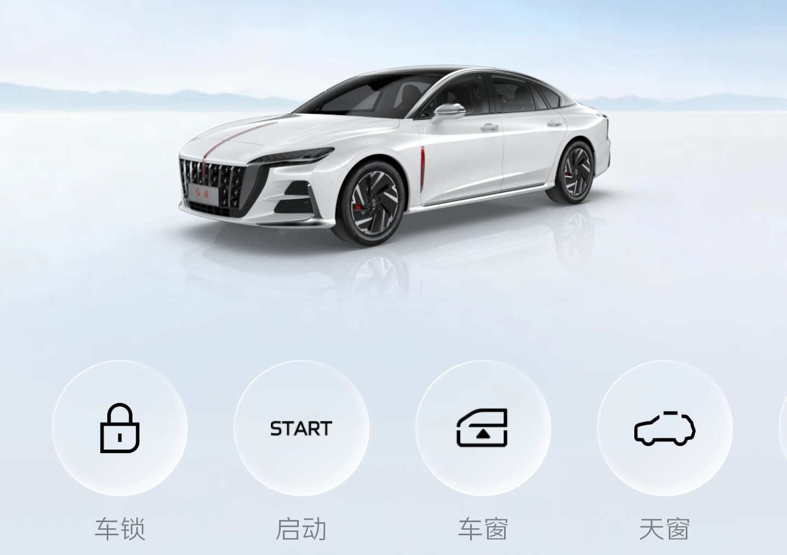

# HONGQI H6 OTA

HongQi H6 OTA Update Package.

## Usage

1. Download the update package from [Releases].
2. Extract and copy it to a USB drive.
3. Insert it into the USB port below the center console.
4. Go to "Settings - System - System Update - USB Update".

[Releases]: https://github.com/kitty-panics/HONGQI-H6-OTA/releases
